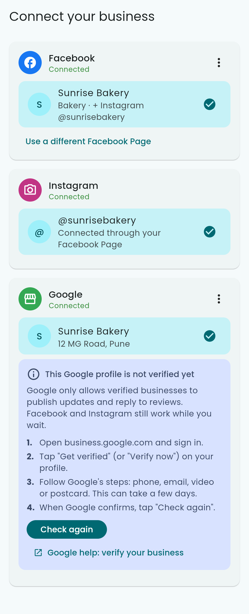
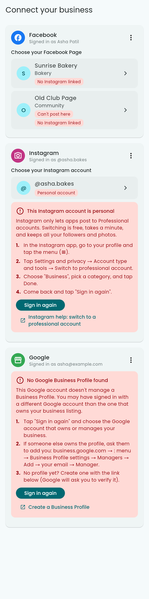

# Neev Udaan

AI social media posts and Google review replies for any business. The app works on Android, iOS, macOS, Windows and the web.

**What a new user sees:**
1. Sign up.
2. **Connect your business.** "Continue with Facebook" connects the Facebook Page and its linked Instagram in one step. "Continue with Google" connects the Google Business Profile. The user picks the right profile. If something isn't set up (a personal Instagram, no Page admin rights, an unverified Google profile), the app explains how to fix it step by step, with a **Check again** button.
3. **Check your details.** The name, category, phone, website, address, logo and brand colors are pre-filled from the connected profiles.
4. Create posts.

| Everything connected | Problems found, with fixes |
|---|---|
|  |  |

**Phase 1 (done):**
- Sign up and sign in.
- Workspaces with roles.
- Brand setup: logo upload, colors taken automatically from the logo or chosen by hand, and tone of voice.
- **Topic → AI post ideas → image post.** The image is AI generated, with the real logo and the headline placed on top.
- Free re-layouts of a post, a post library, and share or download.
- A monthly image allowance per plan.

**Account connection (done):** Facebook Login (Pages + linked Instagram), Instagram Login (for Instagram accounts not linked to a Page), and Google Business Profile. Sign-in happens on each platform's own page, and tokens are stored encrypted on the server only.

**Later phases:** posting directly to Instagram, Facebook and Google Business Profile (Phase 2), Google review alerts with AI replies (Phase 3), and billing and team invites (Phase 4).

| Layout "band" (square) | Layout "top" (portrait) |
|---|---|
|  |  |

*These samples use a placeholder background. In the app, Imagen generates the photo.*

## How it works

```
Flutter app (app/)                      Firebase / Google Cloud (functions/)
─────────────────                       ─────────────────────────────────────
Sign in (Firebase Auth)
Brand setup ── upload logo ──► Storage
            ── extractBrandColors ────► k-means palette from logo (sharp)
Create ─────── generateIdeas ─────────► Claude (structured JSON ideas + captions)
       ─────── generatePost ──────────► Imagen (background, no text)
                                        └► compositor: logo + headline + brand colors
                                           (sharp + resvg, Poppins font) → Storage
Post ───────── relayoutPost ──────────► re-render, same background (free)
```

- **Why the logo isn't drawn by the AI:** image models distort logos and misspell text. Imagen produces only the scene. The app places the real logo file and the headline text, so the brand always looks right.
- **Security:** AI output, usage counters, plans and memberships can only be written by Cloud Functions. The app can edit only an allow-listed set of brand fields. All of this is enforced in `firestore.rules` and `storage.rules`.
- **Region:** functions run in `asia-south1` (Mumbai). Imagen runs in `us-central1`; change this with `IMAGEN_LOCATION`.

### Connecting accounts

```
App: "Continue with Facebook" ─ startConnect ──► returns facebook.com login URL (with one-time state)
Browser: user signs in on Facebook and approves
Facebook ──► oauthCallback: exchanges the code, encrypts and stores tokens (brands/{bid}/private),
             lists Pages + linked Instagram, detects problems → brands/{bid}/connections/facebook
App (watching that document): shows the Pages → selectProfile → links it to the brand and fills
             in missing details and logo. "Check again" → refreshConnection (no new sign-in).
```

The problems it detects, with the fix shown to the user, are listed in `app/lib/guidance.dart`.

| Code | Meaning |
|---|---|
| `NO_PAGES` | No Facebook Page, or none was selected on the Facebook screen |
| `NOT_PAGE_ADMIN` | The user can't post on that Page |
| `IG_NOT_LINKED` | The Page has no linked Instagram (offers "Sign in with Instagram" instead) |
| `IG_PERSONAL_ACCOUNT` | The Instagram account must be switched to Professional |
| `PERMISSIONS_MISSING` / `IG_PERMISSION_DECLINED` | Permissions were switched off (reopens the permission screen) |
| `NO_LOCATIONS` | This Google account manages no Business Profile |
| `NOT_VERIFIED` | The Google profile isn't verified yet (Facebook and Instagram still work) |
| `API_NOT_APPROVED` | Google hasn't approved this app's Business Profile API access yet |
| `LOGIN_CANCELLED` / `TOKEN_EXPIRED` | Sign in again |

### Data model (Firestore)

```
users/{uid}                         defaultWorkspaceId
workspaces/{wid}                    name, ownerUid, plan
  members/{uid}                     role: owner | admin | editor
  usage/{YYYY-MM}                   images, ideaRequests
  brands/{bid}                      name, industry, tone, audience, location, language,
                                    website, phone, logoPath, colors{primary,secondary,accent,onPrimary},
                                    setupComplete, channels{facebook, instagram, google}  (server-written)
    connections/{provider}          status, accountName, candidates[], issues[], selectedId
    private/{provider}              encrypted tokens (no app access)
    ideaSets/{id}                   topic, platform, ideas[]
    posts/{id}                      status, platform, format, layout, headline, caption,
                                    hashtags, imagePath, backgroundPath
```

`oauthStates/{state}` holds one-time sign-in states and can't be accessed from the app. Phase 3 will add `brands/{bid}/reviews/{id}`.

## Setup

### 1. Accounts you need

1. **Firebase project** (console.firebase.google.com). Upgrade it to the **Blaze** pay-as-you-go plan, which Cloud Functions and Vertex AI require.
2. In the same Google Cloud project, **enable the Vertex AI API**:
   `gcloud services enable aiplatform.googleapis.com --project YOUR_PROJECT_ID`
3. **Anthropic API key** from platform.claude.com.

### 2. Backend

```bash
npm install -g firebase-tools
firebase login
```

Edit `.firebaserc` and put your project id in place of `YOUR_FIREBASE_PROJECT_ID`. Then:

```bash
cd functions && npm install && npm test
```

```bash
firebase functions:secrets:set ANTHROPIC_API_KEY
```

```bash
firebase deploy --only functions,firestore,storage
```

In the Firebase console:
- Enable **Authentication → Email/Password**.
- Create the **Firestore** database and the **Storage** bucket.

When you first deploy `storage.rules`, the CLI asks for permission for Storage rules to read Firestore. Say yes: the membership checks depend on it.

Give the functions' service account permission to call Imagen:

```bash
gcloud projects add-iam-policy-binding YOUR_PROJECT_ID \
  --member="serviceAccount:$(gcloud projects describe YOUR_PROJECT_ID --format='value(projectNumber)')-compute@developer.gserviceaccount.com" \
  --role="roles/aiplatform.user"
```

### 3. Connecting Facebook, Instagram and Google

The redirect (callback) URL for all three platforms is:

```
https://asia-south1-YOUR_PROJECT_ID.cloudfunctions.net/oauthCallback
```

**Meta (Facebook and Instagram)** at developers.facebook.com:
1. Create an app of type **Business**.
2. Add the **Facebook Login for Business** product. Under Settings → *Valid OAuth Redirect URIs*, add the callback URL.
3. Add the **Instagram** product, using "API setup with Instagram login". Add the same callback URL as the redirect URL. Note the separate *Instagram app ID* and *Instagram app secret*.
4. Under App settings → Basic, add a Privacy Policy URL, a Terms URL and a data deletion URL.
5. **Until App Review is approved, only people added under App roles (Admins, Developers, Testers) can connect.** Submit these permissions for **Advanced Access** in App Review: `pages_show_list`, `pages_read_engagement`, `pages_manage_posts`, `business_management`, `instagram_basic`, `instagram_content_publish`, `instagram_business_basic` and `instagram_business_content_publish`. Complete **Business Verification** as well.

**Google** at console.cloud.google.com, in the same project:
1. Enable these APIs: **My Business Account Management API**, **My Business Business Information API** and **My Business Verifications API**.
2. Set up the OAuth consent screen: type External, add the scope `.../auth/business.manage`, and add test users while it's in testing.
3. Create Credentials → OAuth client ID, type **Web application**. Add the callback URL under *Authorized redirect URIs*.
4. **Apply for Business Profile API access**: search "GBP API access request form". Until it's approved, the app shows users "Google connection is waiting for approval". After approval, submit the consent screen for verification.

**Configure the functions:**

```bash
cp functions/.env.example functions/.env.YOUR_PROJECT_ID
```

Fill in `META_APP_ID`, `INSTAGRAM_APP_ID` and `GOOGLE_CLIENT_ID` in that file. Then set the secrets:

```bash
firebase functions:secrets:set META_APP_SECRET
```

```bash
firebase functions:secrets:set INSTAGRAM_APP_SECRET
```

```bash
firebase functions:secrets:set GOOGLE_CLIENT_SECRET
```

```bash
openssl rand -base64 32 | firebase functions:secrets:set TOKEN_ENCRYPTION_KEY --data-file=-
```

Then deploy:

```bash
firebase deploy --only functions,firestore
```

Every secret must exist before you deploy. If you aren't using one of the platforms yet, set its secret to any placeholder; its Connect button then shows "isn't switched on yet".

### 4. App

Install Flutter 3.50 or later. Then:

```bash
cd app
dart pub global activate flutterfire_cli
flutterfire configure --project=YOUR_PROJECT_ID
flutter run
```

`flutterfire configure` replaces the placeholder `lib/firebase_options.dart` with your project's real keys. To try the app in a browser, use `flutter run -d chrome`. For Windows and macOS desktop, use `flutter run -d windows` or `flutter run -d macos`.

### Troubleshooting a first deploy

These came up when deploying to the `neev-udaan` project:

- **"Build failed … missing permission on the build service account"**: grant `roles/cloudbuild.builds.builder` to `PROJECT_NUMBER-compute@developer.gserviceaccount.com`.
- **"Failed to set invoker … not belong to a permitted customer"**: the Google Workspace organization's *Domain restricted sharing* policy blocks public apps. Override it for this project only: IAM & Admin → Organization Policies → Domain restricted sharing → Override → Allow All. Then make the callable functions public (`roles/run.invoker` for `allUsers`), or redeploy changed functions.
- **The app shows "internal" right after sign-up**: the functions aren't public yet (see the previous point).
- **Logo upload is denied**: grant `roles/firebaserules.firestoreServiceAgent` to `service-PROJECT_NUMBER@gcp-sa-firebasestorage.iam.gserviceaccount.com`, so the Storage rules can check membership in Firestore.
- **Images fail**: enable the Vertex AI API and grant `roles/aiplatform.user` to the compute service account.

### Local development with emulators

```bash
echo "ANTHROPIC_API_KEY=sk-ant-..." > functions/.secret.local
```

```bash
cd functions && npm run serve
```

Then point the app at the emulators (`useAuthEmulator`, `useFirestoreEmulator`, `useStorageEmulator`, `useFunctionsEmulator`) while developing.

## Costs (approximate)

| Item | Cost |
|---|---|
| Post ideas (Claude Opus 5.5, ~6 ideas per request) | a few US cents per request |
| Imagen image | about US$0.04 per image (check current Vertex AI pricing) |
| Firebase (Auth, Firestore, Storage, Functions) | free tier covers early usage |

Plan limits are in `functions/src/lib/types.ts` (`PLAN_LIMITS`). Free is 15 images per month.

## Testing status

- `functions`: unit tests for color extraction, text wrapping and every layout and format (`npm test`).
- An end-to-end run against the Firebase emulators passed these checks: sign-up, workspace creation, brand edits, access denied to other users, clients blocked from writing AI output, usage or plan, the free-plan brand limit, and input validation.
- **Not yet verified:** the Storage membership rule. It uses a cross-service lookup into Firestore, and the sandbox that built this code couldn't run that lookup in the emulator. Run the logo-upload step once against your real project to confirm it.
- `functions`: tests for each connector, using fake Facebook, Instagram and Google responses. They cover Pages with and without Instagram, Page roles, switched-off permissions, personal Instagram, unverified and missing Google profiles, pending API approval, expired logins, and token encryption.
- An end-to-end emulator run of the connection flow passed these checks:
  - Workspace setup with no details, and retrying it safely.
  - The Facebook login URL and its one-time state.
  - The callback: cancelled sign-in, unknown and reused states.
  - The app can't read tokens or sign-in states, or write connection data.
  - Disconnecting, and completing setup.
- `app/lib/dev/preview.dart` renders the Connect screen with sample data. That is how the screenshots above were made.
- **Not yet run:** real calls to Claude, Imagen, Facebook, Instagram and Google. They need your keys and approved platform apps.

## Roadmap

**Phase 2: publishing**
- Account connection: done.
- Publish now or on a schedule (Cloud Tasks) to the connected Page, Instagram account and Google profile.
- A scheduled job to refresh tokens and re-check connections.

**Phase 3: reviews**
- Receive Google Business Profile notifications (`NEW_REVIEW`) through Pub/Sub, with a polling backup.
- Claude drafts a reply in the brand's tone, with privacy-safe rules for healthcare, legal and finance.
- Push notification (FCM) → approve or edit → `reviews.updateReply`.

**Phase 4: business**
- Team invites and roles.
- Subscriptions: RevenueCat for iOS and Android in-app purchases; Stripe or Razorpay on web and desktop.
- Admin dashboard.

**Start these approvals now:**
- Meta Business Verification and App Review.
- Google Business Profile API access request.
- Google OAuth verification.
- A D-U-N-S number for the Apple and Google Play developer accounts.
